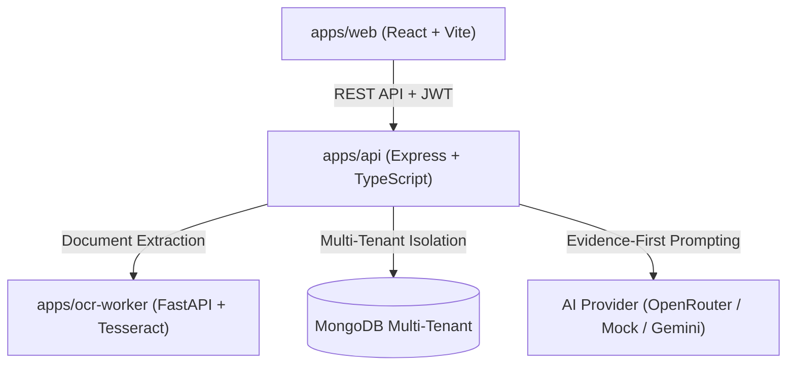

# BrandGuard AI System Architecture

## Overview
BrandGuard AI is an evidence-first brand governance platform designed to enforce brand guidelines, approved facts, and regulatory constraints across organizational publishing workflows.

## High-Level Topology

## Core Tenets
1. **Evidence-First Verification**: Every finding references specific draft excerpt offsets and policy rule IDs.
2. **Deterministic Fallbacks**: Heuristic and rule engine checks run before any LLM invocations.
3. **Workspace Isolation**: Cryptographic tenant boundaries with automated filter injection.
4. **Segregation of Duties**: Authors cannot review their own drafts.
